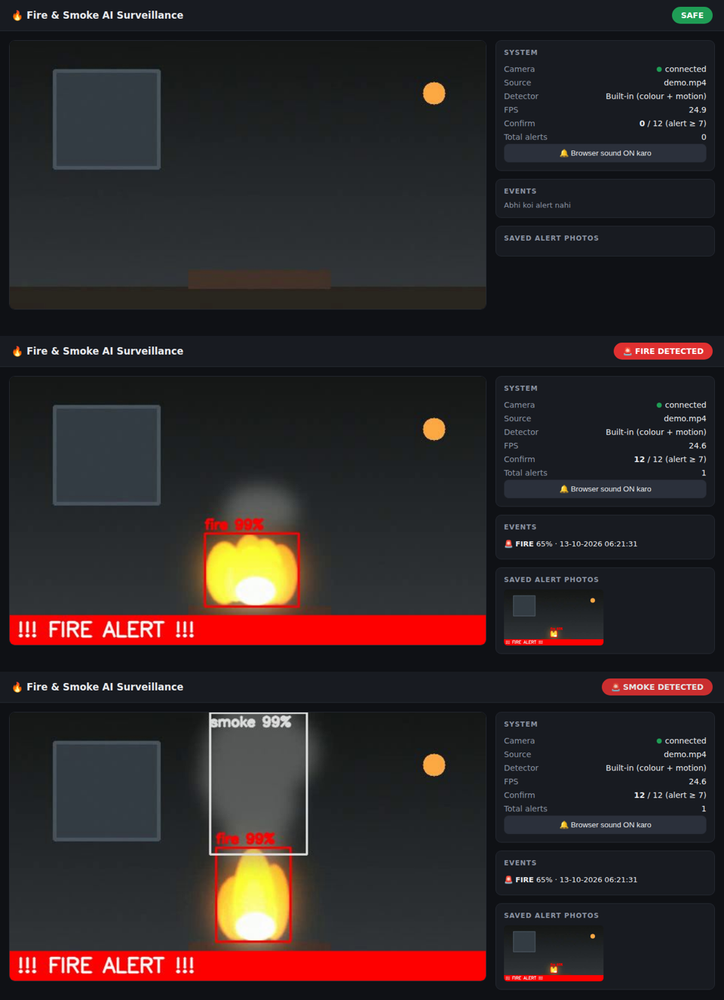

# AI Fire & Smoke Surveillance (Real-Time, localhost dashboard)

DroidCam / Webcam / Video  ->  detection  ->  browser dashboard + beep + alert photo

* **Bina training ke chalta hai** (built-in colour + motion detector).
* `best.pt` (YOLO) rakhoge to apne aap YOLO use hoga (zyada accurate).
* Dashboard hamesha khulta hai, camera na mile tab bhi (wo reconnect karta rehta hai).

## Demo dashboard preview
Yeh simulated `demo.mp4` se SAFE, fire-alert aur smoke-alert dashboard states dikhata hai; yeh real camera footage nahi hai.



## Sabse tez start (Windows)
1. Python 3.9+ install karo (install me **"Add Python to PATH"** tick karo)
2. Folder me **`start_demo.bat`** double-click -> demo video par test (browser khud khulega)
3. Sahi dikhe to **`start.bat`** double-click -> asli DroidCam camera

Mac/Linux:
```
pip install -r requirements.txt
python app.py --demo      # test
python app.py             # DroidCam
```
Browser: **http://localhost:5000** (port busy ho to terminal me naya URL likha aata hai)

## DroidCam setup
* PC par DroidCam Client kholo aur phone se connect karke usme video chalao.
* `config.py` me `SOURCE = 0` PC ke `DroidCam Video` virtual camera ko use karta hai; project alag se phone ke Wi-Fi stream se connect nahi karega.
* Agar local virtual camera kisi aur index par ho, `SOURCE` ko us index (jaise `1`) par set karo.

## Files
| File | Kaam |
|---|---|
| `app.py` | Main program + dashboard |
| `config.py` | Saari settings |
| `detector.py` | Built-in detector + YOLO detector |
| `camera.py` | DroidCam/webcam reader (auto reconnect) |
| `selftest.py` | Camera ke bina pipeline test (`python selftest.py`) |
| `make_demo_video.py`, `demo.mp4` | Simulated flame/smoke demo video |
| `1_train_in_colab.ipynb` | YOLO training (optional, accuracy badhane ke liye) |

## D-Fire se fire/smoke detection (YOLO)
Abhi `best.pt` maujood na ho to app built-in colour + motion detector chalata hai; D-Fire dataset khud realtime me load nahi hota. Trained model banane aur istemal karne ke liye:
1. `1_train_in_colab.ipynb` ko Google Colab me kholo aur **T4 GPU** select karke cells upar se neeche chalao. Notebook Hugging Face ke D-Fire raw mirror ko download karta hai, 14,122 train / 3,099 validation / 4,306 test images banata hai, phir YOLOv8s train aur test karta hai.
2. Notebook se download hua `best.pt` is project folder me copy karo.
3. `pip install -r requirements-yolo.txt` chalao, phir app restart karo. `config.py` ka `DETECTOR = "auto"` `best.pt` milne par YOLO automatically use karta hai.

D-Fire original dataset CC BY 4.0 license ke tahat hai. Required citation aur source notebook me diye gaye hain. Trained model ke baad bhi apne camera par false-positive/false-negative results check karo; fire safety ke liye certified alarm ki jagah istemal mat karo.
Live CPU inference ke liye `config.py` me `IMG_SIZE = 320` rakha hai. GPU/tez computer ho to 640 try kar sakte ho; isse speed kam ho sakti hai.

## Tuning (config.py)
| Problem | Fix |
|---|---|
| False alarm zyada | `MIN_HITS` 9-10, `MIN_FIRE_AREA` 0.003, `CLASSIC_SMOKE=False` |
| Detect miss / der se | `MIN_HITS` 4-5, `MIN_FIRE_AREA` 0.001 |
| FPS kam | `MAX_WIDTH` 640 |
| Phone se dashboard dekhna | `WEB_HOST = "0.0.0.0"`, phir `http://<PC-IP>:5000` |

## Troubleshooting
* **Dashboard nahi khul raha:** terminal/CMD me `python app.py` chalao aur jo URL likha aaye wahi kholo. Error aaye to bhejo.
* **"Camera connect ho raha hai" dikh raha:** DroidCam app khula? same WiFi? VPN band? Windows Firewall me Python allow? IP badla to `config.py` me update.
* **`python` not found:** Python install karo (PATH tick karke) ya `py app.py` try karo.

## Zaroori limitations (sach)
* Built-in detector **rang + harkat** se kaam karta hai. **Ghoomti hui orange/laal cheez, flicker karti bulb, tez roshni badlav** par false alarm de sakta hai. Dhuan detection experimental hai.
* Jaha accuracy zaroori ho wahan trained YOLO model use karo aur apne camera ki images se fine-tune karo.
* Asli aag se test mat karo. Ye system **extra safety layer** hai, asli smoke detector / fire alarm ki jagah nahi.
